# Architecture

## 1. Data flow (ingestion → deterministic compute → AI → typed output → validation → human → persistence)

```mermaid
flowchart LR
  U[Upload PDF / image] --> H{{Hash + dedupe<br/>deterministic}}
  H --> P[Document parser<br/>pdf.js text layer → words + boxes<br/>deterministic]
  P --> INJ[Injection / risk scan<br/>deterministic]
  P --> EX[Extraction<br/>rules extractor = default<br/>Claude adapter = optional]
  EX --> G{{Grounding + schema validation<br/>every value must exist in cited words<br/>deterministic}}
  G --> CONF[Confidence scoring<br/>deterministic]
  CONF --> DB[(SQLite<br/>fields, provenance)]
  DB --> RE[Reconciliation engine<br/>decimal math, tolerances, tax,<br/>duplicates<br/>deterministic]
  RE --> EXC[Exceptions + recommendation<br/>typed, deterministic]
  EXC --> EXP[Exception explainer<br/>template = default<br/>Claude rewrite = optional, number-verified]
  EXP --> UI[Review UI<br/>source highlights, edit, override]
  UI -- correction --> DB
  DB -. re-run .-> RE
  UI --> AP[Approval workflow<br/>RBAC, thresholds, separation of duties<br/>deterministic state machine]
  AP --> AUD[(audit_events)]
  AP --> OUT[Export adapter<br/>CSV / XLSX file only]
  OUT -. never .-> PAY[[Payments / ERP posting<br/>NOT IMPLEMENTED]]
```

## 2. Agent vs. deterministic boundary

| Stage | Implementation | Why |
|---|---|---|
| Parsing, hashing, dedupe | Deterministic | Bytes in, words+boxes out; no judgement. |
| Document classification (PO/GRN/INV) | Deterministic title/keyword rules (+ confidence) | Cheap, testable; LLM would add cost without gain on templated titles. |
| **Field extraction** | **Rules extractor (default)**; **Claude adapter (optional)** | Layouts vary → the one place a model adds real value (unseen supplier layouts). Constrained: must cite word IDs; values re-checked against those words; failures fall back to rules; confidence capped. |
| Normalisation (dates, locales, numbers) | Deterministic | Date math and locale parsing must be exact. |
| **Reconciliation, tolerances, tax, rounding, duplicates, currency** | **Deterministic only** | Money. Must be reproducible and auditable. The LLM has no write path here. |
| Recommendation | Deterministic (blocking severity ⇒ Hold, any open ⇒ Review, else Ready) | Policy, not prediction. |
| **Exception explanation** | **Template (default)**; **Claude rewrite (optional)** | Plain-language wording helps non-accountants; every number in the rewrite is verified against the evidence or the rewrite is discarded. |
| Approval workflow, RBAC, audit | Deterministic | Access policy and state transitions. |
| Export | Deterministic, file-only, formula-injection-safe | No external write. |

Agents deliberately **not** created: a separate "matching agent", "tax agent", "duplicate agent", "orchestrator agent". Those are functions. Only extraction and explanation have an optional model, and both have a deterministic fallback so the app is fully usable offline.

## 3. Components

- `shared/` — Zod schemas (single source of truth for types), decimal `Money` helpers.
- `server/ingest` — pdf.js text-layer reader → `TextLayer` (`pages[].words[] {id,text,bbox,conf}`); prompt-injection scanner; (OCR adapter boundary).
- `server/extract` — rules extractor, locale-aware parsers, grounding validator, optional Claude extractor.
- `server/engine` — `matchBundle(po, grns, invoice, settings, context) → MatchResult`; no I/O.
- `server/workflow` — state machine, RBAC, approvals, audit writer.
- `server/export` — CSV (+ formula neutraliser) and XLSX.
- `server/llm` — Claude transport with timeout, retry, circuit breaker, rate limit; injectable for tests.
- `server/app.ts` — Hono HTTP API; `server/db.ts` — `node:sqlite` schema + migrations.
- `web/` — React SPA; pdf.js canvas preview with overlay boxes.

## 4. Persistence
SQLite (`data/app.db`), WAL mode. Tables: `organizations, users, settings, documents, bundles, extractions, fields, line_items, runs, exceptions, decisions (agent_decisions), approvals, corrections, exports, idempotency_keys, audit_events`. Money stored as decimal **strings**. Timestamps UTC ISO-8601; document dates are date-only strings (no timezone is invented); UI renders audit time in the organization's timezone.

## 5. Connectors

| Connector | Status | Notes |
|---|---|---|
| Local filesystem upload | **Available** | Default intake. |
| SQLite | **Available** | `node:sqlite` (Node 24). |
| PDF text layer (pdf.js) | **Available** | Native-text PDFs. |
| OCR (scanned images) | **Optional / not built in MVP** | Adapter boundary exists (`TextLayer` with per-word `conf`); no OCR engine installed (`tesseract` absent on this machine). Image upload is rejected with an explicit message. |
| Claude API (extraction/explanation) | **Optional, disabled, mock-tested only** | No `ANTHROPIC_API_KEY` on this machine; never run live. |
| ERP / payment / accounting posting | **Blocked by design** | Not implemented; no route exists. |
| Email / Gmail / calendar | **Blocked** (not needed) | Not connected; not used. |
| MCP servers | **Not used** by the app | Build-time tools only. |
| CSV / XLSX export | **Available** | File download only. |

## 6. Failure and recovery
Timeouts + bounded retries + circuit breaker on LLM calls → rules fallback. Upload and approve are idempotent. Re-running a match never mutates prior runs (new `runs` row; previous retained). A failed extraction leaves the bundle in `needs_review` with an explicit error and a retry button. Rollback: `DELETE /api/bundles/:id` and `npm run seed -- --reset`.
